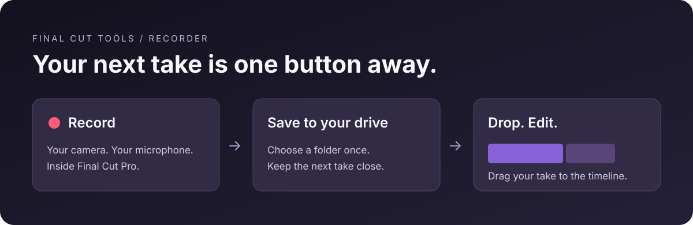

<div align="center">

# Final Cut Tools

### Less setup. More creating.

Native tools that keep your creative workflow inside Final Cut Pro.

[](tools/recorder)
[](#requirements)
[](LICENSE)
[](#project-status)

**[Get started](#quick-start) · [Recorder](#recorder) · [Contribute](CONTRIBUTING.md)**

</div>

---

## Recorder

**Open Final Cut. Press Record. Talk. Drop your take onto the timeline.**

No separate recording app. No hunting for the file you just saved. The recorder opens as a workflow extension in Final Cut Pro, with your camera preview, microphone level, and finished takes in one place.



*Workflow illustration. The extension uses native macOS controls in a floating Final Cut Pro window.*

### Designed for an easy next take

- **Stay in Final Cut.** Open the recorder from **Window → Extensions → Final Cut Recorder**.
- **Use your own gear.** Choose a webcam and a separate audio interface or microphone.
- **Remember the setup.** Keep your selected devices and recording destination between sessions.
- **Record to your chosen drive.** Write the movie directly to a folder you select, including an external SSD.
- **Keep takes within reach.** Drag a finished take from the recorder onto the browser or timeline.
- **Watch your sound.** A live microphone meter helps you catch missing input before recording.
- **Keep files manageable.** H.264 video and mono AAC audio in a `.mov` container; 1080p at 30 fps when supported by the camera.

## Quick start

This is currently a **build-from-source preview**, not a signed, notarized download.

```sh
git clone https://github.com/pbanuru/final-cut-tools.git
cd final-cut-tools
python3 scripts/build.py --install
```

1. Open **Final Cut Recorder** from Applications once to register the extension.
2. In Final Cut Pro, choose **Window → Extensions → Final Cut Recorder**.
3. Allow camera and microphone access. Pick your devices.
4. Choose a recording folder, preferably on an external SSD if your Mac is low on space.
5. Press **Record**, then **Stop**. Drag your take onto the timeline.

You need an open library and project to drop a take onto a timeline. The recording folder must stay connected and writable. The recorder does not silently fall back to another drive.

## Requirements

| Component | Current requirement |
| --- | --- |
| Mac | Apple silicon |
| macOS | 15.6 or later |
| Final Cut Pro | An installed version that supports workflow extensions |
| Build tools | Xcode with its command-line tools selected, plus Python 3 |
| Extension runtime | Apple's `ProExtension.framework` from the official Workflow Extension SDK, or the local runtime bundled with an installed Final Cut Pro |
| Capture devices | A camera and microphone recognized by AVFoundation |

The build script searches `/Library/Frameworks` for the SDK, then the installed Final Cut Pro app for a local development runtime. To select an SDK explicitly:

```sh
python3 scripts/build.py --framework /path/to/ProExtension.framework --install
```

Apple SDKs and runtime binaries are **not included in this repository**. Use the official SDK and appropriate signing for distribution. A local build is ad-hoc signed.

## Storage, without the mystery

The recorder saves new takes directly to the selected folder. Final Cut's library, imported copies, render files, and proxies have their own storage settings.

For an SSD-based editing setup, keep the Final Cut library and its cache on the SSD as well. Use APFS for the drive that holds the library. If you want to avoid duplicate copies of recorded media, review Final Cut's import settings and use **Leave files in place** when appropriate.

Keep a separate backup of important recordings. A working SSD and a backup serve different purposes.

## Troubleshooting

| Problem | Try this |
| --- | --- |
| The extension does not appear | Open the containing app from Applications once. If needed, reopen Final Cut Pro. |
| Camera or microphone access was denied | Check **System Settings → Privacy & Security → Camera / Microphone**, then reopen the extension. |
| Preview is unavailable | Close other camera recording windows, reconnect your camera, and reopen the extension. |
| Record is unavailable | Choose a recording folder and wait for the camera and microphone setup to finish. |
| Your SSD was disconnected | Reconnect it or select another recording folder. New recordings are never redirected automatically. |
| A take will not drop onto the timeline | Open a library and project first, then drag the take into the timeline or browser. |

## Project status

An early native recorder is implemented. A local build has opened in Final Cut Pro 12.3 on macOS 26.5 and recorded 1920×1080 H.264 video with 48 kHz mono AAC audio from a Logitech C920e and Scarlett Solo to an external APFS SSD.

Preview sizing and frame-rate fixes are undergoing host verification. An AppKit layout check confirms the recorder view fills a smaller host and follows resizing; the latest live preview and timeline drag-and-drop still need end-to-end checks. This is a development preview, not a stable release.

Current scope is a single camera and microphone, live preview and metering, direct-to-folder capture, and draggable takes. There is no automatic timeline insertion, multicamera capture, screen recording, or signed release installer yet.

### Developer references

- [Apple: building a workflow extension](https://developer.apple.com/documentation/professional-video-applications/building-a-workflow-extension)
- [Apple: drag-and-drop into Final Cut Pro](https://developer.apple.com/documentation/professional-video-applications/supporting-drag-and-drop-for-data-sent-to-final-cut-pro)
- [CommandPost's workflow extension source](https://github.com/CommandPost/CommandPost-App/tree/master/CommandPost%20Workflow%20Extension), consulted for host setup, view layout, and lifecycle patterns. This recorder's implementation is original.
- [Marker Data's workflow extension source](https://github.com/TheAcharya/MarkerData/tree/main/Source/Marker%20Data/Workflow%20Extension), consulted for a Swift controller and constraint-based content layout.

## Tools

| Tool | Purpose | Source |
| --- | --- | --- |
| Recorder | Record yourself without leaving Final Cut Pro | [tools/recorder](tools/recorder) |

Have an idea that removes a repeated step from your editing workflow? Open an issue describing the workflow and the step you want to remove.

## Contributing

Start with [CONTRIBUTING.md](CONTRIBUTING.md). Keep changes focused, test them in Final Cut Pro, and update this README when behavior changes.

Agent instructions live in [AGENTS.md](AGENTS.md); `CLAUDE.md` links to the same source.

## License

[MIT](LICENSE) for this project's source. Final Cut Pro and Apple's SDKs remain subject to their own licenses.
